## 📊 UIII Act4: Importación y Descripción de Datos
## 🎓 Asignatura: Soluciona problemas de Machine Learning
## 📚 Nivel: Tercer semestre de preparatoria
## 🤖 Especialidad: Inteligencia Artificial
## 📈 Dificultad: Cero a principiante
## 🐍 Lenguaje: Python
## 🛠️ Herramientas: Visual Studio Code, Pandas, Matplotlib y CSV

## Cursos en linea

## TABLA ORIGINAL DE EMPLEADOS
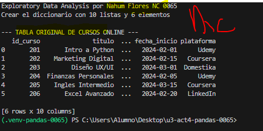

## 7. Convertir el DataFrame en archivo CSV
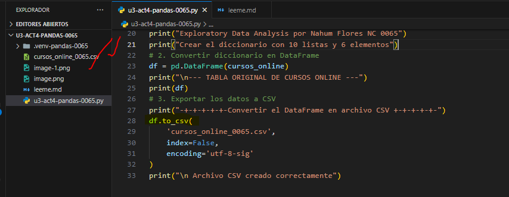

## Datos del cvs --> base de datos
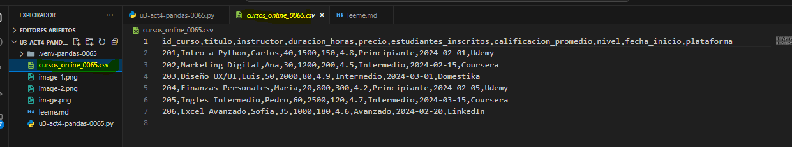

## 8 leer los datos del archivo csv
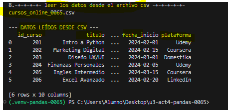

## Primeros y ultimos registros
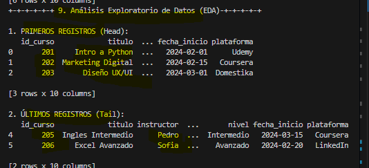

## 6. Dimensiones y estructura
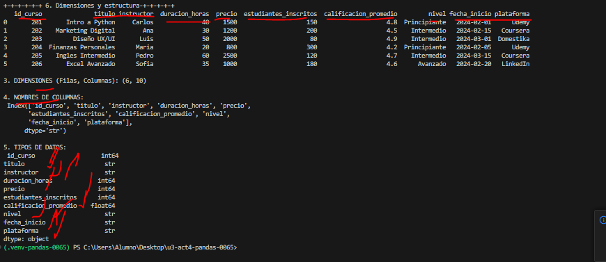

## 7. Estadisticas y limpieza
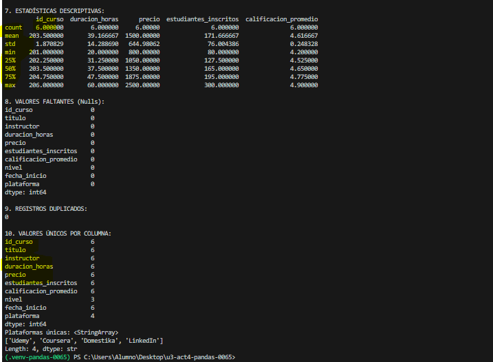

## 8 y 9 Ordenamiento filtrado y agrupacion
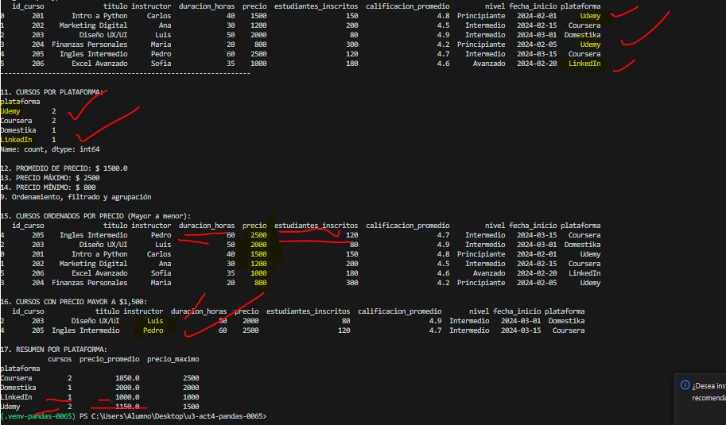

## 18. Gráfica de barras: cursos por plataforma
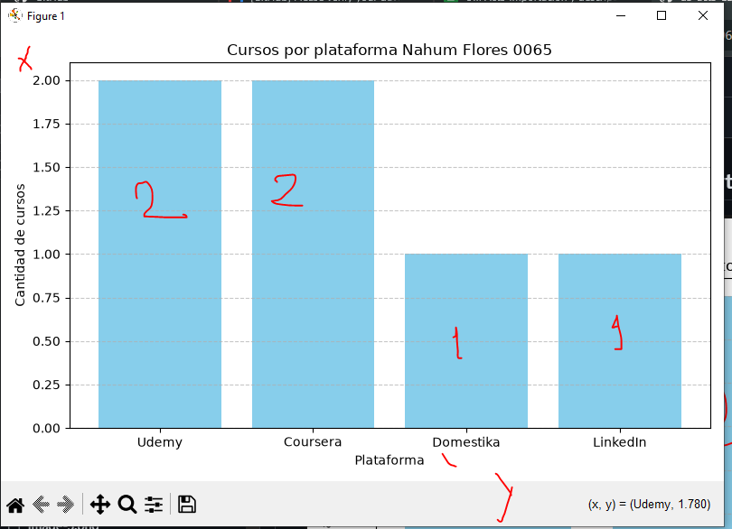

## 19. Gráfica de barras: Precio por curso
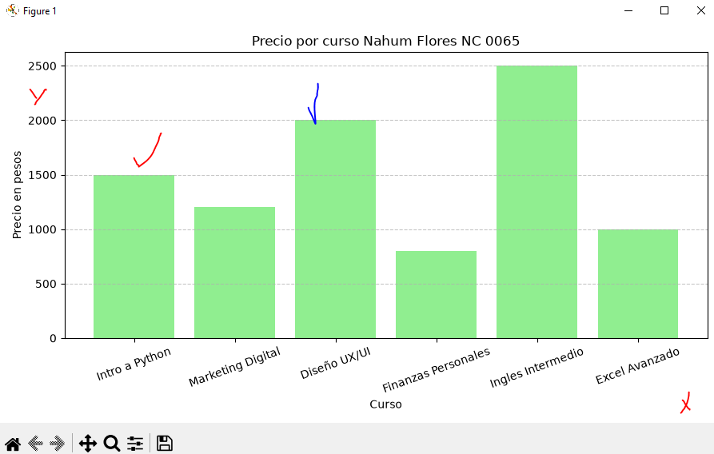

## 20. Histograma: duracion de cursos
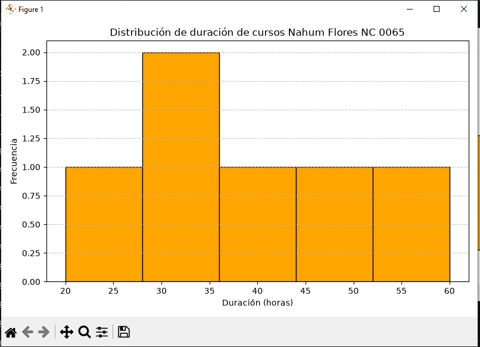

## 21. Gráfica de dispersión: duracion vs precio
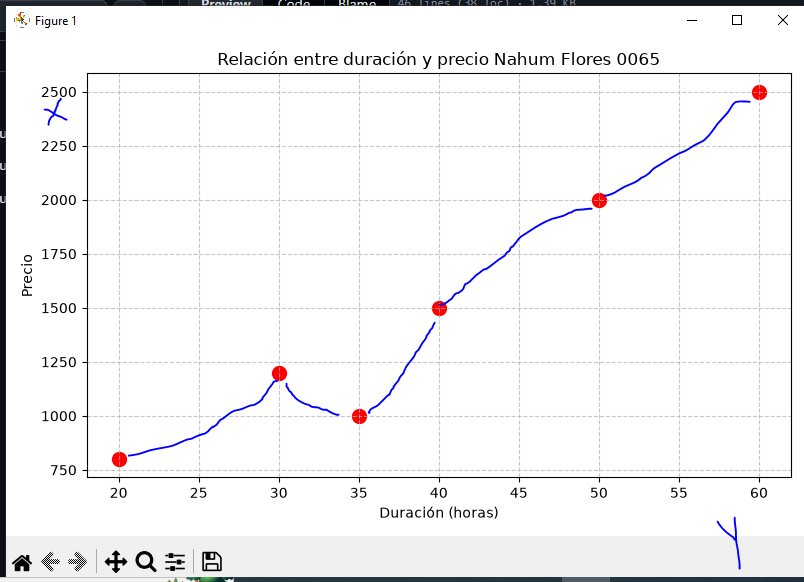

## 22. Diagrama de caja: Distribucion de precios
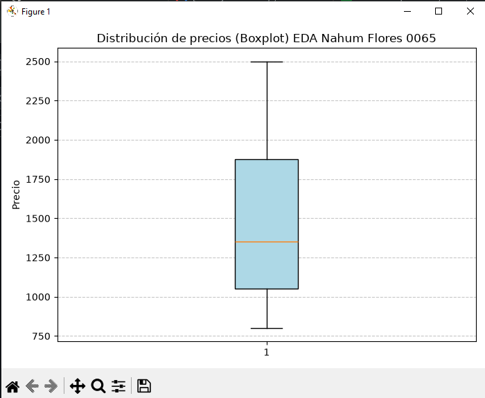

## 23. Matriz de correlación
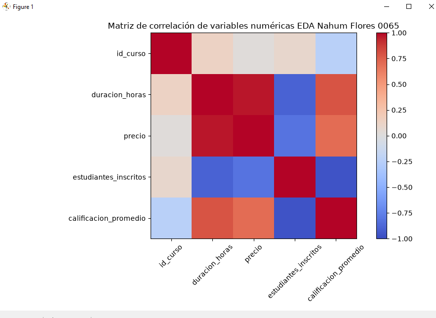